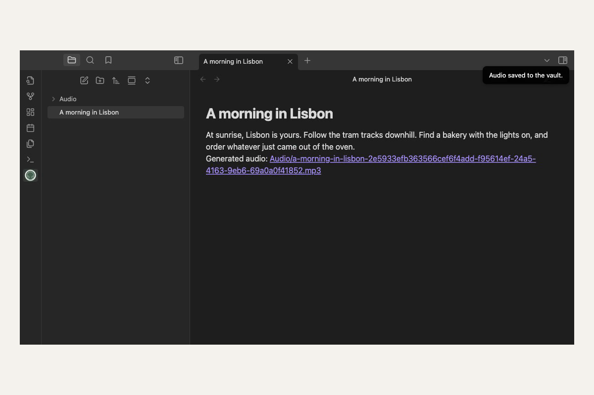

# AudioVault

Tap the headphones. Hear your note.

AudioVault reads your Obsidian notes aloud. Open a note and tap the headphones icon to start listening without downloading an MP3 first. You can also save a note as an MP3 for offline listening.

AudioVault is a free [MIT-licensed](LICENSE) plugin. Generating audio requires your own Cartesia account and API key. The plugin sends the readable text of the open note directly to Cartesia over the internet. Playing a saved MP3 needs no account or connection and uses no credits.

## Getting started

1. [Install AudioVault](#installation) and add your [Cartesia API key](https://play.cartesia.ai/keys) in Settings → AudioVault.
2. Open a note and tap the headphones icon in the ribbon. Playback starts as soon as the first part is ready, or uses the MP3 if it's already saved.

## Commands

| Command (palette) | What it does |
| --- | --- |
| **Play/Pause current note** | Plays the saved MP3 if available or starts generation and playback; run again to pause or resume |
| **Download audio (no playback)** | Saves an MP3 without starting playback |
| **Regenerate and play current note** | Generates new audio and plays it |
| **Stop** | Cancels generation and playback |

The headphones button shows generation progress (for example, `3/8 parts`) and whether the MP3 is ready, outdated, or missing.

## Cartesia pricing

New audio uses credits from your Cartesia account. If you choose a paid plan, Cartesia bills you directly.

- Free: 20,000 credits per month at $0/month.
- Pro: 100,000 credits per month at $5/month.

See [Cartesia pricing](https://cartesia.ai/pricing) for current plans and terms.

## Installation

**From the community store** (once approved): Settings → Community plugins → Browse → AudioVault → Install → Enable.

**Manual installation:**

1. Download `main.js` and `manifest.json` from the [latest release](https://github.com/piotrlo/obsidian-audio-vault/releases/latest).
2. Put both files in `.obsidian/plugins/audio-vault` inside your vault.
3. Restart Obsidian, then enable AudioVault in **Settings → Community plugins**.

**Via BRAT:** add `piotrlo/obsidian-audio-vault` as a beta plugin.

Then open **Settings → AudioVault**, create an API key at [play.cartesia.ai/keys](https://play.cartesia.ai/keys), and paste it. Jacqueline is the default English voice; Marcin and Agnieszka are available for Polish. **Browse voices** searches the voices your own Cartesia account can use and filters by language (`pl`, `fr`) or accent (`en-GB`). To force a language, enter e.g. `pl-PL` in **Language (optional override)**.

**Upgrading from a manual install of 1.0.2 or earlier:** disable the old plugin first — its folder was `.obsidian/plugins/obsidian-audiovault`. Notes, MP3s and `Generated audio` links keep working. Re-enter your Cartesia key if prompted.

## Offline playback

To save audio without playing it, run **Download audio (no playback)** from the command palette. Once the file is saved, open the note and tap the headphones icon to listen offline.

By default, AudioVault saves MP3s in an `Audio/` folder next to the note. If you use Obsidian Sync or another sync tool, check that it includes MP3 files before you go offline. Where supported, Media Session shows the note title and adds play/pause to system media controls.

For generation on iOS the text is split into smaller parts; keep Obsidian open while it works, because background generation is not guaranteed.

## Playback and interrupted downloads

- **Fast start:** playback begins after the first part; the next part is prepared in the background.
- **One MP3 only:** the note is linked to a file once generation completes. Until then, parts live in the plugin's `pending-audio` folder.
- **Resume:** run the same command again without changing the note text, voice, language, or chunk size. Fully downloaded parts are reused instead of paid for twice. AudioVault never retries on its own; a failed transfer can still consume credits, so check Cartesia usage before resuming.
- **Chunking:** sentences are split where possible, 500 characters per part by default (**Advanced options → Chunk size**).
- **Sanitizing:** images, HTML, code blocks and front matter are stripped before synthesis; only readable text is sent.

## Privacy and network use

- Generating audio requires a Cartesia account. AudioVault sends the readable text of the active note directly to Cartesia. See Cartesia's [privacy policy](https://cartesia.ai/legal/privacy) before converting sensitive notes.
- The API key is stored per vault, per device, in local storage — outside synced plugin settings, and not in a system keychain.
- Voice browsing sends only your search query and language filter to Cartesia, never note content.
- AudioVault has no telemetry, ads, or proxy and does not update itself. Saved MP3s are plain files in your vault.

## Technical details

- **Format:** MP3 only.
- **Pipeline:** buffered parts with one part prepared ahead; the vault file is written once the job finishes.
- **Interrupted jobs:** partial parts stay under `pending-audio` for a later resume.
- **Compatibility:** older generated MP3s stay playable from their `Generated audio` links, without a note version to compare against.

## License and support

MIT — see [LICENSE](LICENSE).

- **Issues:** [GitHub Issues](https://github.com/piotrlo/obsidian-audio-vault/issues)
- **Site:** [audio-vault.app](https://audio-vault.app)
